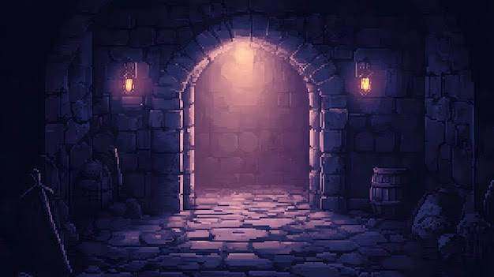

# ByteCrawler
</break>
<p align="center">
  
</p>
Image from: Adobe Stock
</break>
Learn Python like you learn a language: a pixel-dungeon learning path with a Python snake guide, a boss fight, a community tab and a sandbox. It is a static site (plain HTML, CSS and JavaScript), so there is nothing to build or install.

## Folder structure

```
bytecrawler/
├── index.html            # all pages (Home, About, Learning path, Boss, Contact, Community, Dashboard)
├── css/
│   └── style.css         # all styles
├── js/
│   ├── ui.js             # theme toggle, menus, contact form
│   ├── app.js            # lessons, map, Python guide snake, boss fight, dashboard, tiny Python interpreter
│   └── community.js      # Reddit-style community tab
├── assets/
│   ├── favicon.svg
│   └── images/           # map, heroes, boss, backgrounds
├── .nojekyll             # tells GitHub Pages to serve files as-is
├── .gitignore
└── README.md
```

## Run it locally

Serve the folder (recommended, so the 3D boss arena can load its textures):

```bash
python3 -m http.server 8000
# then open http://localhost:8000
```

## Accounts and database

Login, sign-up and saved progress (XP, checkpoints, boss record) use a hosted Supabase database.
It is off until you paste two keys into `js/config.js`; until then the site keeps its browser-only
demo login. Setup takes about 10 minutes: see [`supabase/SETUP.md`](supabase/SETUP.md).

```
supabase/schema.sql   # tables, sign-up trigger, security rules (run once in the SQL editor)
supabase/SETUP.md     # step-by-step setup
js/config.js          # your project URL + public key
js/account.js         # sign up, log in, load and save progress
```

## Publish on GitHub Pages

1. Create a new repository on GitHub (for example `bytecrawler`).
2. Push this folder:
   ```bash
   cd bytecrawler
   git init
   git add .
   git commit -m "Initial commit"
   git branch -M main
   git remote add origin https://github.com/<your-username>/bytecrawler.git
   git push -u origin main
   ```
3. On GitHub open **Settings → Pages**, set **Source** to **Deploy from a branch**, choose **main** and **/ (root)**, then **Save**.
4. After a minute your site is live at `https://<your-username>.github.io/bytecrawler/`.

All file paths are relative, so the site works from a sub-path like this, from a custom domain, or from any other static host (Netlify, Cloudflare Pages, Vercel).

## Members


| Member | Role | University | Year | Contact |
| --- | --- | --- | --- | --- |
| **** | Design Leader | Asia University | 1st year | [](mailto:) |
| **Lê Trần Lâm Vinh** | Member | Asia University | 1st year | [vinhlamle2003@gmail.com](mailto:vinhlamle2003@gmail.com) |
| **Hoàng Xuân Nhi** | Member | Asia University | 1st year | [hnhi20307@gmail.com](hnhi20307@gmail.com) |
| **** | Member | Asia University | 1st year | []() |
| **** | Member | Asia University | 1st year | []() |


## Notes

- Boss fight: Phase 1 is the Wyrm; beat it and the Storm Wyrm (Phase 2) rises and hurls lightning whenever you miss a round. Edit `TESTS1` / `TESTS2` in `js/app.js` to change the rounds.
- If you open `index.html` by double-clicking it, some browsers block the 3D arena textures. The page shows a message and the fight still works; use the local server above to see the arena.
- Fonts (Google Fonts) and the 3D boss arena (three.js from cdnjs) load from CDNs, so visitors need an internet connection. The boss fight still works without the 3D arena.
- Progress and community posts live in the browser tab only and reset on reload.
- Pages use `#hash` links (for example `#course`), so no server-side routing is needed.

## End-of-boss flow (result screen, cutscene, login, records)

Files: `js/result.js`, `css/result.css`, overlay markup at the end of `index.html`, `assets/video/*`.

- **Mission Complete** (win): papyrus treasure map, clear time, best time, XP, rank. Click anywhere (or Enter / Space) to play the cutscene.
- **Cutscene**: `assets/video/cutscene.mp4` (volume starts at 50%, slider + mute in the corner). The **Hold to skip** button must be held about 1.1 s (mouse, touch, or hold Space / Enter). When it ends or is skipped, **Continue a journey** opens the Dashboard.
- **Game Over** (lose): papyrus map with a pixel menu. **Continue** opens the Learning path, **Quit** opens the Dashboard.
- **Dashboard** has a *Boss record* card (best time, last clear, victories, defeats, last runs).
- **Login** page (`#login`) and a Log in button in the header. It is a demo: name and email are kept in this browser's localStorage, passwords are never stored.
- Boss timer starts at the first Attack and stops on the win or the fall (`BCEnd.start / win / lose` in `js/boss.js`).
- Design review without fighting the boss: open `index.html?preview=win` or `?preview=lose` (or run `BCEnd.preview("win")` in the console).
- Esc closes the result screen and returns to the boss room.


## Hero sprites

Boss-arena heroes (Knight, Wizard, Archer, Assassin) use `assets/images/*-sheet.png`: 768x768, 3x3 cells of 256px, 9 attack frames with the effect drawn in. Idle = frame 0. Timing (`FD`, `ST`, `TI`) and per-class feet/centre offsets (`CS`) are in `js/arena.js`. Team avatars are `assets/images/avatar-*.png`. Run `node tests/sheets.test.js` after changing a sheet.
